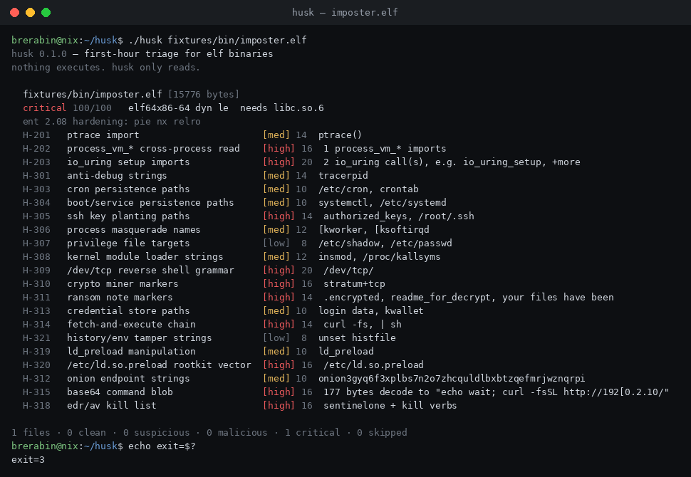
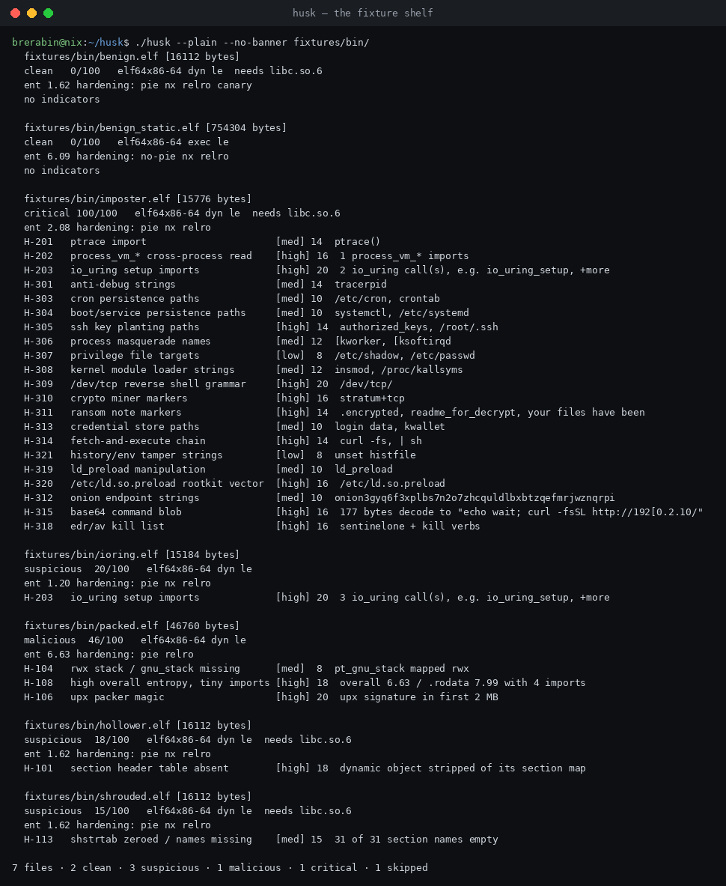
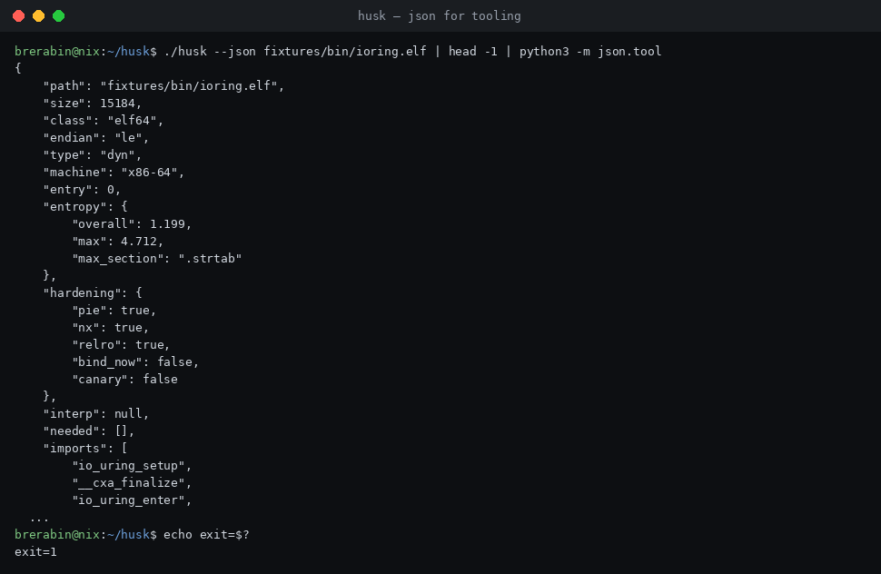

# husk

**first-hour static triage for ELF binaries.**

what does it import. what does it reach for. what is hidden in the shell
something left behind. one static binary, zero dependencies, nothing
executes — husk only reads.

built for the moment an IR consultant drops a suspicious binary on a
linux box and has minutes, not a lab. the ELF ecosystem has verbose
structure dumps (`readelf`), mitigation auditors (`checksec`), and
heavyweight RE frameworks (radare2, ghidra, capa + rule database). the
gap between them is a scanner that answers one question fast:
**is this file worth my night, and why.**

```
$ ./husk fixtures/bin/imposter.elf
husk 0.1.0 — first-hour triage for elf binaries
nothing executes. husk only reads.

  fixtures/bin/imposter.elf [15776 bytes]
  critical 100/100   elf64 x86-64 dyn le  needs libc.so.6
  ent 2.08 hardening: pie nx relro
  H-201   ptrace import                      [med] 14  ptrace()
  H-202   process_vm_* cross-process read    [high] 16  1 process_vm_* imports
  H-203   io_uring setup imports             [high] 20  2 io_uring call(s)
  H-301   anti-debug strings                 [med] 14  tracerpid
  H-305   ssh key planting paths             [high] 14  authorized_keys, /root/.ssh
  H-309   /dev/tcp reverse shell grammar     [high] 20  /dev/tcp/
  H-320   /etc/ld.so.preload rootkit vector  [high] 16  /etc/ld.so.preload
  ...
```

## why

- **io_uring is radioactive.** google disabled it in chromeos, android
  (seccomp) and all of production; kctf paid out multiple critical
  io_uring exploits; hardening guides now recommend restricting it.
  binaries importing `io_uring_setup/enter/register` deserve a flag the
  moment they are seen. husk does that (H-203).
- **linux runs the estate.** ~63% of servers, ~90% of public cloud
  workloads — and first-hour field triage for ELF still means either a
  200-line readelf dump or spinning up a full RE framework.
- **static glibc hides in plain sight.** statically-linked binaries embed
  `/etc/ld.so.preload` and `LD_PRELOAD` strings inertly. husk knows the
  difference and does not cry wolf (loader rules only fire on binaries
  that actually participate in dynamic loading).

## rules

44 weighted indicators, each with a mitre att&ck ref. three families:

| family | range | what it watches |
|---|---|---|
| structure | H-101..H-114 | missing/shredded section maps, entry point outside exec segments, w+x segments, rwx stacks, upx magic, entropy anomalies, rpath hijack, custom interpreters |
| imports | H-201..H-206 | ptrace, process_vm_*, **io_uring_***, dlopen-only profiles, setuid+exec pivots, socket/dup2/execve tridents |
| strings | H-301..H-322 | anti-debug/anti-vm, cron/systemd/ssh persistence, masquerade names, kernel module loaders, /dev/tcp shells, miners, ransom notes, onion endpoints, credential stores, fetch-and-execute chains, base64 command blobs, dga clusters, c2 ip lists, edr kill lists, ld.so.preload, wallet strings |

`./husk --rules` prints the full registry with weights and mitre refs.

## verdicts

score = sum of distinct rule weights, capped at 100.

| band | score | exit |
|---|---|---|
| clean | < 15 | 0 |
| suspicious | 15-44 | 1 |
| malicious | 45-74 | 2 |
| critical | 75+ | 3 |

non-elf inputs are skipped, never counted. wire the exit code into any
gate: `husk --quiet untrusted/ || alert`.

## what it reads

- ELF32 and ELF64, little and big endian (mips/arm IoT payloads included)
- program headers, dynamic segment (needed/rpath/runpath/bind-now),
  dynsym imports, interpreter, section names
- shannon entropy overall, per-section and for .text specifically
- bounded printable-string extraction (24 MB cap, 511 chars per string)
- hardening side-notes: pie / nx / relro+bind-now / canary — checksec's
  job, shown as context, not the verdict

## what it looks like







## what it refuses to do

- no execution. not even of the file it distrusts most.
- no network. ever.
- no trust in its input: every parse read is bounds-checked. the fuzz
  suite feeds it truncated and byte-flipped binaries for breakfast.

self-scan note: scanning husk itself flags critical — the scanner
carries its own rule strings. string rules match text; the truth of a
match lives in context. static analysis sees the corpse, not the crime.

## build

```
make            # cc -O2 -Wall -Wextra -pedantic
make test       # unit + fixture assertions (93 checks)
make e2e        # 26 end-to-end flows incl. truncation fuzz
make static     # statically-linked binary
```

no configure. no dependencies. c99, compiles with gcc and msvc.

## fixtures

`fixtures/bin/` ships synthetic elf stubs so anyone can exercise husk
without touching real malware. every fixture is harmless by
construction: the imposter declares symbols it never calls, the packer
carries a deterministic random blob, the hollower is a mangled copy of
the benign binary. sources live in `fixtures/src/`, regenerable via
`tools/gen_blob.py` and `tools/mangle.py`.

| fixture | verdict | exercises |
|---|---|---|
| benign.elf | clean 0 | honest dynamic binary |
| benign_static.elf | clean 0 | static glibc, inert loader strings |
| shrouded.elf | suspicious 15 | section-name index destroyed |
| hollower.elf | suspicious 18 | section map erased entirely |
| ioring.elf | suspicious 20 | io_uring imports, nothing else |
| packed.elf | malicious 46 | upx magic + 8.0 entropy section |
| imposter.elf | critical 100 | twenty indicators stacked |

## json

`--json` emits one object per file plus a summary line — made for
pipes, jq, and SIEM ingestion.

## license

MIT
